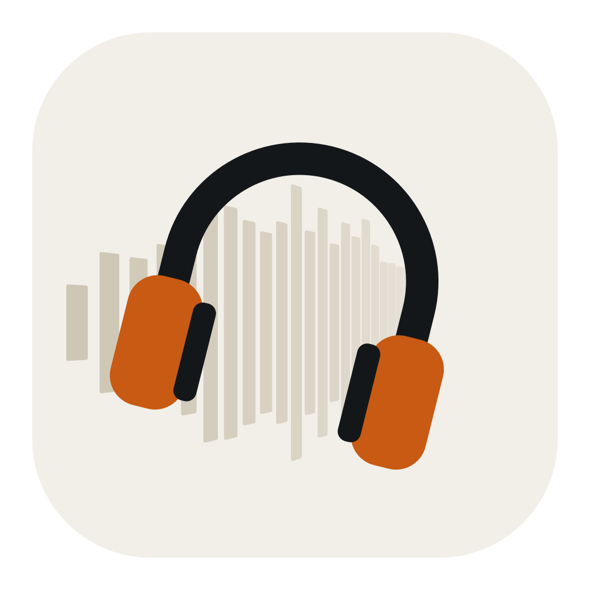
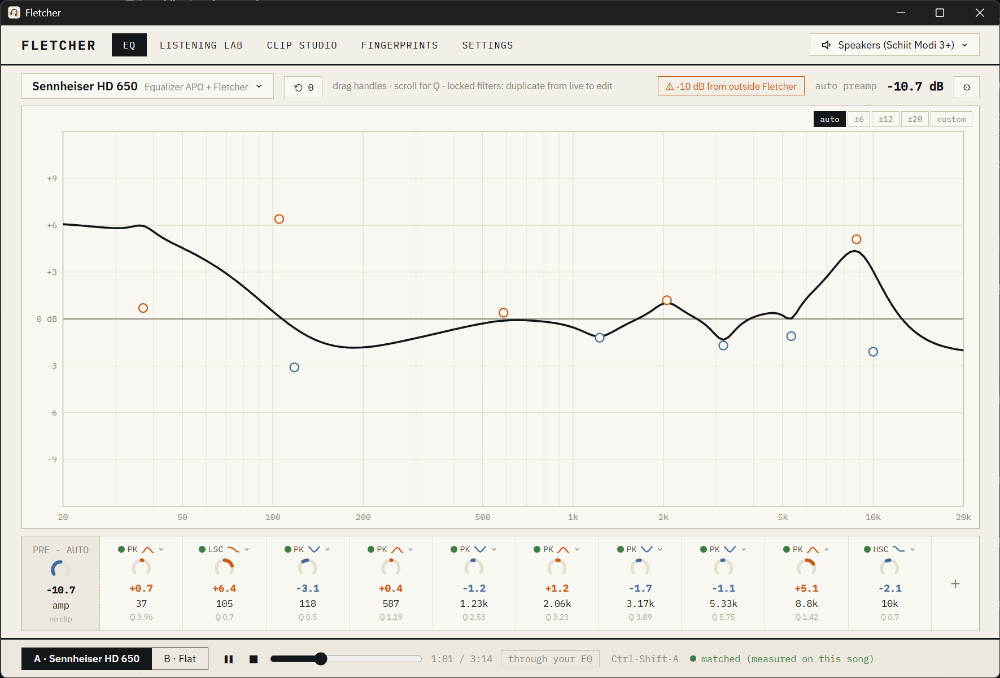
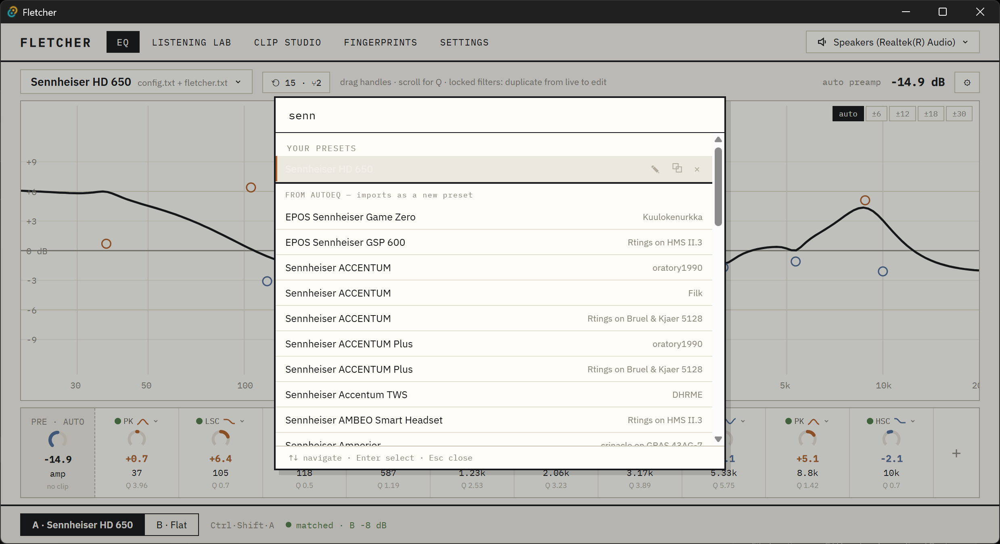
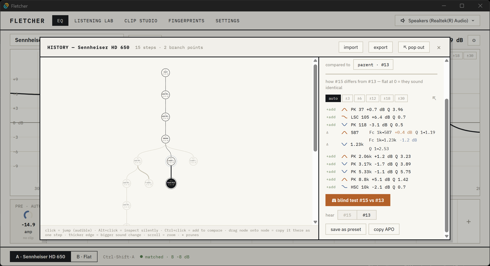
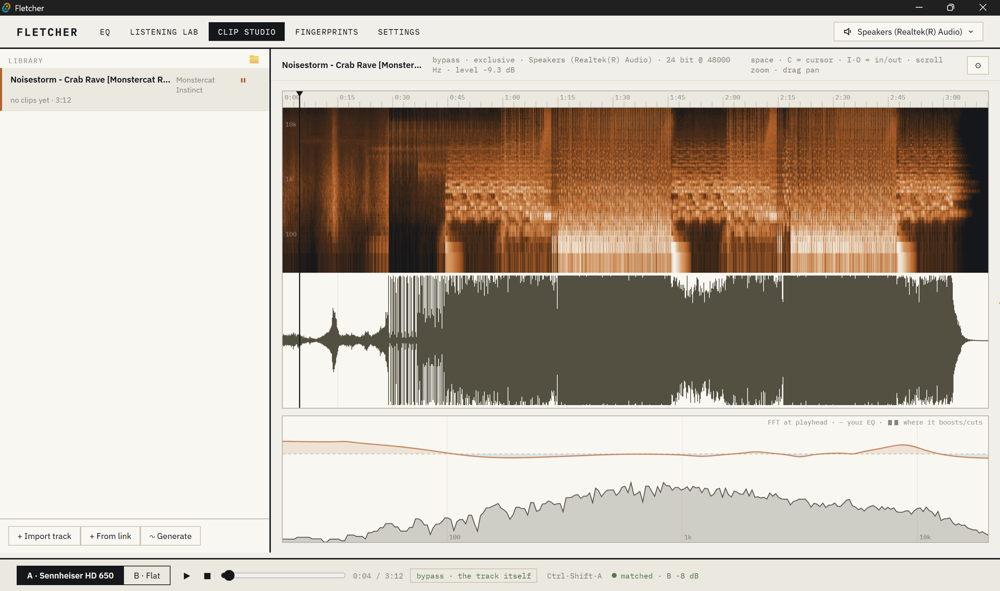

<h1 align="center"> Fletcher</h1>

<p align="center">
  <b>A parametric EQ for Windows that's pleasant to use, and honest about what you can actually hear.</b><br>
  A modern frontend for <a href="https://sourceforge.net/projects/equalizerapo/">Equalizer APO</a>, with built-in level-matched blind listening tests.
</p>

<p align="center">
  <a href="https://github.com/andrewsalinas09/Fletcher/releases/latest"><b>⬇ Download for Windows</b></a>
  &nbsp;·&nbsp;
  <a href="#features">Features</a>
  &nbsp;·&nbsp;
  <a href="#getting-started">Getting started</a>
  &nbsp;·&nbsp;
  <a href="#build-from-source">Build from source</a>
</p>

<p align="center">
  
</p>

## Why Fletcher?

Equalizer APO is the best system-wide EQ engine on Windows, but editing it means text files or dated interfaces. Fletcher gives it a fast, modern editor, and adds the thing no EQ app has: a way to find out whether your tweak actually sounds different.

When two settings differ in loudness, the louder one almost always "sounds better," even when nothing else changed. Fletcher level-matches every comparison so loudness can't cheat, then lets you run **blind ABX tests** with real statistics. Was that 13 out of 16 skill, or luck? Fletcher tells you.

It's named for the [Fletcher–Munson curves](https://en.wikipedia.org/wiki/Equal-loudness_contour), the classic measurements of how our hearing depends on loudness.

## Features

### Parametric EQ on a live curve
Drag handles to set frequency and gain, scroll to change Q, or dial in exact values in the filter strip. Peaking, shelf, pass and notch filters are all supported. Preamp is calculated automatically so your EQ never clips, and changes are applied system-wide the instant you make them.

### 5,000+ headphone corrections, one search away
Type a headphone name and pick from the [AutoEQ](https://github.com/jaakkopasanen/AutoEq) database. The correction imports as your own preset, ready to tweak. You can also import Peace presets or paste Equalizer APO filter lines.

<p align="center">
  
</p>

### Instant, level-matched A/B
Press **Ctrl+Shift+A** anywhere in Windows to flip between your EQ and flat. Both sides are matched in loudness, so you're comparing the sound, not the volume.

### A history you can branch, compare and test
Every edit is saved to a history tree. Jump back to any version, branch off in a new direction, and see exactly how two versions differ. Unsure whether a change was worth it? Start a blind test between the two versions with one click.

<p align="center">
  
</p>

### Listening Lab: blind tests with real statistics
- **ABX tests:** are A and B actually distinguishable to you?
- **Blind preference tests:** which one do you prefer when you don't know which is which?
- Test on whatever is playing system-wide, or on your own music clips.
- Exact p-values, plus optional adaptive tests that stop early once the answer is clear.

### Clip Studio
Import tracks from files or a link, scrub through them on a waveform and spectrogram, and mark the passages that reveal differences. A live FFT at the playhead shows the music's spectrum with your EQ overlaid, so you can see where it boosts and cuts. A built-in signal generator makes test tones and noise.

<p align="center">
  
</p>

### Fingerprints (experimental)
Measure your own hearing's equal-loudness profile per headphone, without a microphone, using timed listening comparisons.

### Safe with your existing setup
Fletcher adds a single `Include: fletcher.txt` line to Equalizer APO's config and only ever writes its own file. It backs up your config before the first change, never edits files that belong to other tools like Peace, and never makes your audio suddenly louder.

## Getting started

1. Install [Equalizer APO](https://sourceforge.net/projects/equalizerapo/) and enable it for your headphones or speakers in its Configurator. Reboot if it asks.
2. Download the latest installer from [Releases](https://github.com/andrewsalinas09/Fletcher/releases/latest) and run it.
3. Open Fletcher, search for your headphones, and pick a correction. Press **Ctrl+Shift+A** to hear the difference.

> [!NOTE]
> The installer isn't code-signed yet, so Windows SmartScreen shows an "unknown publisher" warning. Click **More info → Run anyway**.

Fletcher is in early development (0.x). Expect rough edges, and please [open an issue](https://github.com/andrewsalinas09/Fletcher/issues) if something breaks.

## Build from source

You'll need [Rust](https://rustup.rs/), [Node.js](https://nodejs.org/) and Windows 10 or 11 with Equalizer APO installed.

```sh
cd app
npm install
npm run tauri dev     # run with hot reload
npm run tauri build   # build the installers
```

Run the checks with `cargo test --workspace` and `cargo clippy --workspace --all-targets`.

Fletcher is built with [Tauri](https://tauri.app/), Rust and React. For the architecture, design decisions and roadmap, start at [CLAUDE.md](CLAUDE.md) and the [docs](docs/) folder.

## License

[Apache 2.0](LICENSE)
